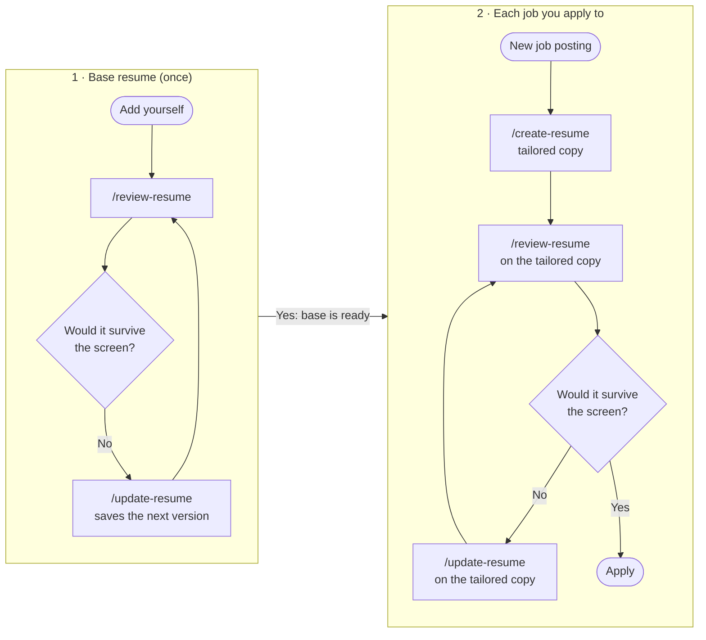

# Workflow

The expected loop, once you're set up. Work on your base resume first,
then make one tailored copy per job.

## 1. Build a strong base resume (once)

Your base resume is `resume/resume-vN.md`, the highest number. It's the one
every tailored copy starts from.

1. `/review-resume <you>`, against the kind of job you want most.
2. `/update-resume <you>` to work through the fixes. This saves `vN+1`.
3. Repeat until the verdict says it would survive.

Each update creates a new version, so you can always go back.

## 2. For each job you apply to

1. **Add the posting first.** Paste the full job description (or its link)
   after any command. It's saved under `job/` and gets a Job Checklist, and
   every later step is judged against it. Pasting is more reliable than a
   link, since many job sites block automated reading.
2. **Tailor it.** `/create-resume <you> <posting>`. You approve the fit plan,
   then pick each bullet.
3. **Check it.** `/review-resume <you> <posting> <tailored file>`.
4. **Apply** with the tailored copy.

Comparing several jobs? `/review-resume <you> acme globex initech` screens
the same resume against up to 5 postings and ranks them by fit. That
helps you decide where to apply first.

## 3. When something changes

| Situation | Do this |
| - | - |
| You finished a new project or got promoted | Add it to `history/work-history.md`, then `/update-resume <you> "add my new project"`. |
| You changed a bullet in your base resume | `/update-resume` asks whether to carry the change into your tailored copies. |
| A recruiter or interviewer gave you feedback | `/update-resume <you> "<their feedback>"` |
| The posting changed | Re-add it. The Job Checklist is rebuilt if the requirements changed. |

## What gets saved where

| Command | Reads | Writes |
| - | - | - |
| `/review-resume` | resume, posting, checklist, past reports | `feedback/resume-screen-<posting>-<date>.md`, a new checklist if needed |
| `/update-resume` | resume, latest report or your request | `resume-v(N+1).md`, or a new tailored copy |
| `/create-resume` | history, resume, LinkedIn, posting, checklist | `resume/curated-resumes/resume-vN-<posting>.md` |

No command overwrites an existing file.
